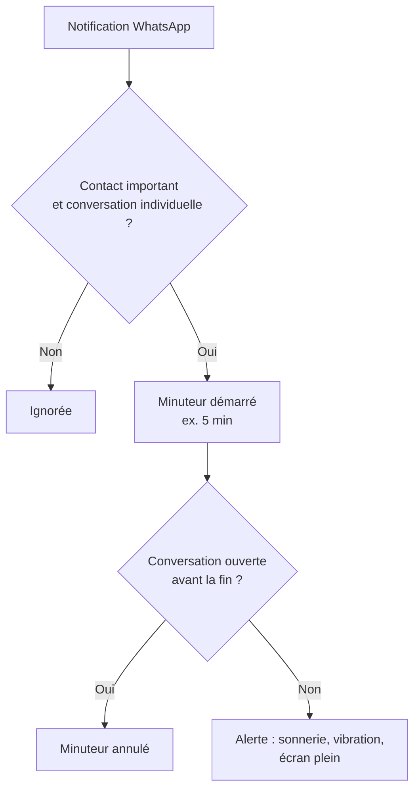

<p align="center">
  
</p>

<p align="center">
  <b>Ne manquez plus jamais un message WhatsApp important.</b><br>
  Si une personne importante vous écrit et que vous ne répondez pas à temps,<br>
  votre téléphone sonne comme un appel, même en silencieux et écran verrouillé.
</p>

---

## Sommaire

- [Le problème](#le-problème)
- [Fonctionnalités](#fonctionnalités)
- [Comment ça marche](#comment-ça-marche)
- [Installation](#installation)
- [Configuration sur le téléphone](#configuration-sur-le-téléphone)
- [Téléphones Infinix, Tecno, itel (XOS / HiOS)](#téléphones-infinix-tecno-itel-xos--hios)
- [Limites connues](#limites-connues)
- [Architecture du code](#architecture-du-code)
- [Débogage](#débogage)
- [Confidentialité](#confidentialité)
- [Feuille de route](#feuille-de-route)

## Le problème

Un parent, un client, un médecin vous écrit sur WhatsApp. Le téléphone est en silencieux, vous dormez ou vous êtes occupé, et le message passe inaperçu pendant des heures.

**Priority Alert** surveille les messages de quelques contacts que vous choisissez. Si l'un d'eux vous écrit et que vous n'ouvrez pas la conversation dans le délai fixé, l'application déclenche une alerte impossible à rater.

## Fonctionnalités

- **Contacts importants** : vous choisissez qui surveiller, avec un délai propre à chacun (1, 2, 5, 10, 15 ou 30 minutes).
- **Pause par contact** : un interrupteur suspend la surveillance d'une personne sans la supprimer.
- **Compte à rebours en direct** : quand un message attend une réponse, la carte du contact affiche « Sans réponse · alerte dans 0:42 ».
- **Alerte façon appel entrant** :
  - sonnerie en boucle sur le canal « alarme », audible même en mode silencieux ou Ne pas déranger ;
  - vibration ;
  - écran plein qui s'allume et s'affiche par-dessus le verrouillage ;
  - bouton « Répondre sur WhatsApp » qui ouvre WhatsApp directement ;
  - arrêt automatique au bout de 2 minutes.
- **WhatsApp et WhatsApp Business** sont surveillés tous les deux.
- **Annulation automatique** : dès que vous ouvrez la conversation (sur le téléphone ou sur WhatsApp Web), le minuteur s'arrête.
- **Survit aux redémarrages** : la surveillance repart toute seule après un redémarrage du téléphone ou une mise à jour de l'application, et les minuteurs en cours sont réarmés.
- **Assistant de configuration** : l'écran principal indique ce qu'il reste à autoriser et ouvre directement le bon écran des réglages.
- **Mode sombre** automatique.

## Comment ça marche

L'application ne se connecte pas à WhatsApp : WhatsApp ne le permet pas pour un compte personnel. Elle lit les **notifications** que WhatsApp affiche, grâce à l'autorisation Android « Accès aux notifications ».



**Détection d'une réponse :** quand vous ouvrez une conversation, WhatsApp retire lui-même sa notification. L'application le voit et annule le minuteur. Balayer la notification pour l'effacer, en revanche, **n'annule pas** le minuteur : le message reste considéré comme sans réponse.

**Messages successifs :** si la même personne envoie plusieurs messages, l'échéance reste celle du premier message ; elle n'est pas repoussée à chaque nouveau message.

**Déclenchement fiable :** l'échéance est surveillée de deux façons :
- une alarme Android de type « réveil », la forme d'alarme que le système retarde le moins ;
- une vérification interne toutes les 10 secondes, au cas où le système retarderait l'alarme.

## Installation

### Option 1 : avec Android Studio

1. Clonez le dépôt :
   ```bash
   git clone https://github.com/codingtaker/whatsAppAgent.git
   ```
2. Ouvrez le dossier dans Android Studio et laissez Gradle se synchroniser.
3. Branchez votre téléphone (débogage USB activé) et cliquez sur **Run**.

### Option 2 : en ligne de commande

Prérequis :
- **JDK 17** : Java 21 ou plus récent ne fonctionne pas avec cette version de Gradle ;
- **SDK Android**, avec la plateforme 35 et les build-tools ;
- un fichier `local.properties` à la racine du projet, qui indique où se trouve le SDK :
  ```properties
  sdk.dir=C:/Users/<vous>/AppData/Local/Android/Sdk
  ```

Compiler l'APK :

```bash
./gradlew assembleDebug
```

L'APK est créé dans `app/build/outputs/apk/debug/app-debug.apk`. Pour l'installer sur un téléphone branché en USB :

```bash
adb install -r app/build/outputs/apk/debug/app-debug.apk
```

### Option 3 : installer l'APK à la main

Copiez `app-debug.apk` sur le téléphone et ouvrez-le. Sur Android 13 et plus, l'autorisation « Accès aux notifications » est alors grisée pour une application installée de cette façon : allez dans **Infos de l'application → ⋮ → Autoriser les paramètres restreints**, puis réessayez.

### Configuration minimale

| | |
|---|---|
| Android | 8.1 (API 27) ou plus récent |
| Testé sur | Infinix HOT 40i, Android 13, XOS 13 |
| Applications surveillées | WhatsApp (`com.whatsapp`) et WhatsApp Business (`com.whatsapp.w4b`) |

## Configuration sur le téléphone

Au premier lancement, la carte **Configuration** de l'écran principal liste les trois autorisations nécessaires. Chaque bouton « Activer » ouvre le bon écran des réglages.

| Autorisation | Pourquoi |
|---|---|
| **Accès aux notifications** | Pour voir les messages WhatsApp qui arrivent |
| **Ignorer l'optimisation de batterie** | Pour qu'Android n'endorme pas la surveillance |
| **Affichage par-dessus les autres applis** | Pour ouvrir l'écran d'alerte même téléphone verrouillé |

Ensuite :

1. Touchez **Ajouter un contact**.
2. Saisissez le nom **exactement comme il apparaît dans WhatsApp**, emojis compris (par exemple `Gisela 🇬🇦`). L'application reconnaît les contacts par ce nom, pas par leur numéro.
3. Choisissez le délai.
4. Touchez **Tester l'alerte** pour vérifier que la sonnerie et l'écran d'alerte fonctionnent.

Pendant que la surveillance tourne, une notification discrète « Surveillance des contacts importants active » reste dans le volet des notifications. Elle est nécessaire pour qu'Android laisse l'application active en arrière-plan.

## Téléphones Infinix, Tecno, itel (XOS / HiOS)

Les surcouches de Transsion sont très agressives avec les applications en arrière-plan. Sans les réglages ci-dessous, l'application peut être arrêtée et ne plus rien détecter.

1. **Démarrage automatique** : touchez **Ouvrir** dans la carte « Infinix, Tecno ou itel ? » en bas de l'écran principal, puis activez Priority Alert dans la liste de Phone Master.
2. **Optimisation de batterie** désactivée, via la carte Configuration.
3. **Verrouiller l'application dans les applis récentes**, si votre lanceur le propose (icône cadenas). Évitez de la balayer hors des récentes.

L'application se protège aussi d'elle-même contre deux comportements de XOS observés pendant les tests :

- **Service d'écoute jamais reconnecté.** Quand XOS tue l'application, il ne reconnecte pas son service d'écoute des notifications, et la demande de reconnexion standard d'Android est ignorée. L'application désactive puis réactive alors son propre service, ce qui force le système à le reconnecter.
- **Gel des applications (« Hiber »).** XOS peut geler l'application et retenir ses alarmes. L'alarme de type « réveil » et la vérification interne toutes les 10 secondes limitent ce risque. Lors des tests, l'alerte s'est déclenchée au plus 10 secondes après l'échéance.

## Limites connues

- **« Répondu » veut dire « conversation ouverte ».** Android ne permet pas de voir vos messages envoyés. Ouvrir la conversation sans répondre annule donc aussi l'alerte.
- **Reconnaissance par le nom.** Le nom saisi doit correspondre exactement à celui affiché dans les notifications WhatsApp. Si vous renommez le contact dans votre répertoire, mettez-le aussi à jour dans l'application.
- **Notifications indispensables.** Si une conversation est mise en sourdine dans WhatsApp, ou si les notifications WhatsApp sont désactivées, l'application ne voit rien.
- **Groupes ignorés.** Seules les conversations individuelles sont surveillées.
- **Pas encore de vrai appel.** L'alerte est une sonnerie locale sur le téléphone, pas un appel téléphonique (prévu en V2).
- **Surcouches constructeur.** Sur certaines surcouches (XOS, MIUI, etc.), le système peut encore retarder ou bloquer l'application malgré les protections ; la fiabilité dépend des réglages de batterie du téléphone.

## Architecture du code

Tout le code se trouve dans `app/src/main/java/com/priorityalert/app/`.

| Fichier | Rôle |
|---|---|
| `WhatsAppListener.kt` | Service d'écoute des notifications. Repère les messages des contacts importants, démarre les minuteurs, et les annule quand la conversation est ouverte. |
| `AlertScheduler.kt` | Programme les alarmes de type « réveil », réarme les minuteurs après un redémarrage, et déclenche les échéances dépassées. Contient aussi `AlarmReceiver`. |
| `WatchService.kt` | Service de premier plan qui garde l'application en vie, force la reconnexion du service d'écoute et lance la vérification toutes les 10 s. Contient aussi `BootReceiver`. |
| `AlertService.kt` | L'alerte elle-même : sonnerie sur le canal alarme, vibration, notification plein écran et ouverture de l'écran d'alerte. |
| `AlertActivity.kt` | Écran d'alerte affiché par-dessus le verrouillage. |
| `MainActivity.kt` | Écran principal : contacts, état de la configuration, raccourcis vers les réglages. |
| `Store.kt` | Stockage local (SharedPreferences) des contacts, des minuteurs en cours et de l'échéance de chacun. |
| `ui/` | Interface en Jetpack Compose et Material 3 : `HomeScreen.kt`, `AlertScreen.kt`, `Avatar.kt` et `Theme.kt` (palette de la marque). |

Ressources graphiques :
- icône adaptative : `app/src/main/res/drawable/ic_launcher_*.xml`, avec une couche monochrome pour les icônes à thème d'Android 13 ;
- icône de la barre d'état : `ic_stat_bell.xml` ;
- logo intégré à l'application : `ic_logo.xml` ;
- versions SVG pour le dépôt : `docs/icon.svg` et `docs/logo.svg`.

**Palette de la marque :**

| Couleur | Code | Usage |
|---|---|---|
| Bleu nuit | `#1B1F3B` | Fonds, texte principal |
| Corail | `#FF6B5B` | Alerte, boutons, cloche |
| Ambre | `#FBBF24` | Pastille « non lu », messages en attente |
| Menthe | `#34D399` | Surveillance active, étapes terminées |

## Débogage

Tous les événements sont écrits dans le journal Android sous l'étiquette `PriorityAlert` : notifications reçues, minuteurs démarrés ou annulés, alertes déclenchées, reconnexions du service d'écoute.

```bash
adb logcat -s PriorityAlert
```

Exemple de séquence normale :

```text
I PriorityAlert: WhatsApp notification from 'Vianel BSI' (com.whatsapp.w4b) -> VIP
I PriorityAlert: Timer started for Vianel BSI: 1 min
I PriorityAlert: Alert for Vianel BSI fired by watchdog (8s after deadline)
```

**Tester sans vrai message.** La version debug accepte un minuteur factice, pratique pour vérifier le comportement écran éteint ou application en arrière-plan :

```bash
adb shell am start -n com.priorityalert.app/.MainActivity --ei debug_timer_seconds 60
```

Ce minuteur est ignoré dans une version release.

Si les journaux du téléphone se vident trop vite (certains téléphones ne gardent que quelques minutes d'historique), agrandissez le tampon :

```bash
adb logcat -G 8M
```

## Confidentialité

- **Tout reste sur le téléphone.** Aucun serveur, aucun compte, aucune connexion Internet utilisée par l'application.
- **Contenu minimal conservé**, et seulement pour vos contacts importants :
  - le texte du message dont le minuteur tourne, pour l'afficher dans l'alerte ; il est effacé quand l'alerte se déclenche ou que la conversation est ouverte ;
  - le dernier aperçu de message de chaque contact important, avec sa date, pour ne pas sonner deux fois pour la même notification. Il est remplacé à chaque nouveau message.
- **Rien d'autre n'est lu.** Les notifications des autres contacts et des autres applications sont ignorées sans être enregistrées.

## Feuille de route

- [x] **V1** : surveillance des notifications, minuteur par contact, alerte locale, fiabilité sur XOS
- [x] **Design** : logo, icône, interface Compose et écran d'alerte façon appel entrant
- [ ] **V2** : vrai appel téléphonique en escalade, par exemple via Twilio, avec un message vocal du type « Koffi vous a écrit il y a 5 minutes »
- [ ] **V2** : niveaux d'escalade (notification, puis sonnerie, puis appel)
- [ ] **V3** : détection de l'urgence par IA, pour adapter le délai au contenu du message (« Salut » ou « Appelle-moi tout de suite »)
- [ ] **V3** : autres messageries (Telegram, SMS…)
